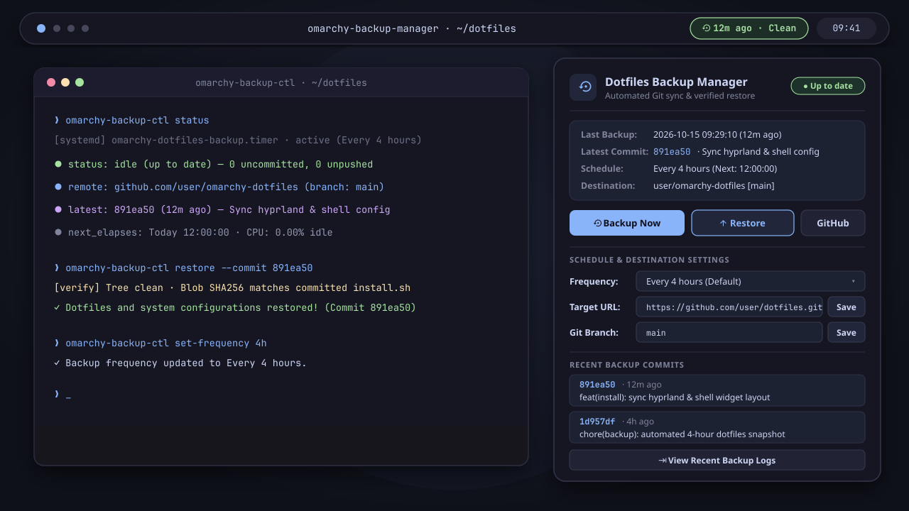

# Omarchy Backup Manager 󰁯

[](LICENSE)
[](https://omarchy.org/)



A lightweight, low-profile [Omarchy](https://omarchy.org/) status bar plugin and management suite for automated dotfiles backup, 1-click system restore, git synchronization, and system configuration snapshots.

---

## ✨ Features

- **Low-Profile Navbar Widget**:
  - Displays a clean, non-intrusive icon (`󰁯`) directly in the Omarchy top bar.
  - Subtle status indication: idle/up-to-date, syncing animation (`󱑎`), or attention required.
  - Detailed tooltip displaying last backup time, latest commit hash, schedule, and destination.
- **Interactive Management Panel**:
  - **1-Click "Backup Now"**: Immediate backup and push with live progress animation.
  - **1-Click "Restore"**: One-button system restore applying dotfiles configurations and updating local configs, theme, and Hyprland without breaking development links. Cryptographically bound to an explicit commit SHA with confirmation prompt for safety.
  - **Schedule Settings**: Change automated backup interval anytime via dropdown (`Every 1 hour`, `2 hours`, `4 hours`, `6 hours`, `12 hours`, `Daily`, or `Disabled`). Dynamically reconfigures systemd user timers.
  - **Target Git Destination**: View and update the GitHub / Git remote target URL and branch directly in the GUI.
  - **Recent Commit History**: Inspect recent backup commits with relative timestamps.
  - **Integrated Log Viewer**: View real-time backup systemd service logs.
- **Ultra-Low CPU & RAM Footprint**:
  - Zero background daemon loops.
  - Efficient 60-second idle polling (only fast-polls during active syncs/restores).
  - Average CPU utilization: `0.00%`.
  - Native QML declarative bindings with zero memory leaks.

---

## 📦 Dependencies

- **Python 3** (>= 3.8, included by default in Omarchy / Arch Linux)
- **Git** (for version tracking, commit history, and remote GitHub synchronization)
- **systemd** (user services & timers: `omarchy-dotfiles-backup.{timer,service}`)
- **Omarchy Shell / Quickshell** (status bar widget host)

---

## 🚀 Installation

### Via Omarchy Plugin Manager (Recommended):
```bash
omarchy plugin add https://github.com/unrealandychan/omarchy-backup-manager.git --enable
```

### Local Development / Manual Setup:
From a local checkout of the repository:
```bash
./install.sh
```

This will:
1. Symlink `bin/omarchy-backup-ctl` to `~/.local/bin/omarchy-backup-ctl`.
2. Link the plugin to `~/.config/omarchy/plugins/arch.backup-manager`.
3. Register the widget in `~/.config/omarchy/shell.json` on the navigation bar.
4. Notify Omarchy Shell to reload plugins automatically.

---

## 🔒 Installer & Runtime Scope

`install.sh`, `uninstall.sh`, and `bin/omarchy-backup-ctl` run entirely as your local user account, without root access, privilege escalation, package managers, or network download scripts.

### Installer (`install.sh` / `uninstall.sh`)

`install.sh` touches only these user-owned paths (verifying current-user UID ownership and refusing symlinks on `shell.json`):

| Path | Change |
|---|---|
| `~/.local/bin/omarchy-backup-ctl` | Symlink to `bin/omarchy-backup-ctl` in this checkout; any differing existing file or link is backed up to `*.bak.<timestamp>` first |
| `~/.config/omarchy/plugins/arch.backup-manager` | Symlink to this checkout; any differing existing directory or file is backed up to `*.bak.<timestamp>` first |
| `~/.config/omarchy/shell.json` | Backed up to `*.bak.<timestamp>`, then `{"id": "arch.backup-manager"}` is inserted into `bar.layout.right` via `O_NOFOLLOW` atomic replacement |

It then runs `omarchy-shell shell rescanPlugins` if `omarchy-shell` is available on `PATH`.

`uninstall.sh` verifies ownership and provenance before removing anything: it unlinks `~/.local/bin/omarchy-backup-ctl` and `~/.config/omarchy/plugins/arch.backup-manager` only when they resolve to this checkout, and removes `arch.backup-manager` from `~/.config/omarchy/shell.json` (after creating a timestamped backup) only when this checkout owns the active plugin link.

### Runtime (`bin/omarchy-backup-ctl` & `plugin/BackupManager.qml`)

- **User service & timer management**: Inspects and manages only the user-level `omarchy-dotfiles-backup.timer` and `omarchy-dotfiles-backup.service` units, plus `journalctl --user -u omarchy-dotfiles-backup.service` for log viewing. When changing the schedule (`set-frequency`), it atomically writes `~/.config/systemd/user/omarchy-dotfiles-backup.timer` (and mirrors to `~/dotfiles/.config/systemd/user/omarchy-dotfiles-backup.timer` if that directory exists and is owned by the current user) without following symlinks.
- **Dotfiles repository (`~/dotfiles`)**: Runs `git` commands (`status`, `rev-parse`, `log`, `remote`) with `cwd=~/dotfiles`. Remote URL updates validate safe schemes (`https://`, `ssh://`, `git@host:path`) and reject option-injection strings (`-`) and `ext::` helpers.
- **Commit-bound restore**: `omarchy-backup-ctl restore --commit <40-hex-sha>` verifies that `~/dotfiles` has a clean tracked working tree, matches `HEAD` to the confirmed 40-character SHA, verifies `restore.sh` against the committed git blob (`git cat-file -e`), and executes `~/dotfiles/restore.sh` strictly from the verified checkout.

---

## 🛠️ CLI Usage (`omarchy-backup-ctl`)

The plugin is backed by the standalone `omarchy-backup-ctl` CLI:

```bash
# Check status and backup metadata (JSON)
omarchy-backup-ctl status

# Trigger an immediate manual backup
omarchy-backup-ctl backup-now
# Or wait for completion:
omarchy-backup-ctl backup-now --wait

# Restore dotfiles bound to an exact, cryptographically verified commit
omarchy-backup-ctl restore --commit <COMMIT_HASH>
# Or restore confirmed local HEAD:
omarchy-backup-ctl restore --head
# (Specifying the target commit binds the restore decision to that exact, cryptographically verified commit, verifying working tree cleanliness and matching committed blob before execution)

# Change automated backup schedule
omarchy-backup-ctl set-frequency 4h     # 1h, 2h, 4h, 6h, 12h, daily, disabled

# Update GitHub / Git destination
omarchy-backup-ctl set-remote "https://github.com/user/my-dotfiles.git"
omarchy-backup-ctl set-branch "main"

# View recent backup logs
omarchy-backup-ctl logs 25
```

---

## 🧪 Testing

A test suite is included in `tests/test-ctl.sh`:

```bash
cd ~/projects/omarchy-backup-manager
./tests/test-ctl.sh
```

---

## 🗑️ Uninstallation

To remove the widget and unlink the plugin:

```bash
cd ~/projects/omarchy-backup-manager
./uninstall.sh
```
